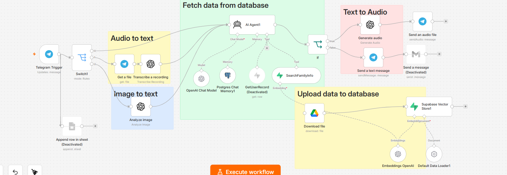
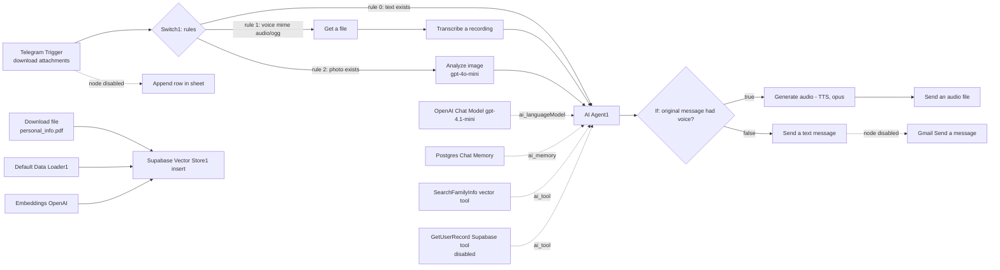

# Answer from vector v2 — multimodal RAG assistant on n8n

A voice/image/text assistant built in n8n: a Telegram message arrives, the workflow decides whether it is **text**, **voice** or **photo**, converts it to text (Whisper transcription or GPT-4o vision), and answers through an **AI agent** that can query a **Supabase vector store** with OpenAI embeddings and keeps per-chat context in **Postgres chat memory**. If the question was spoken, the reply is generated as audio and sent back as a Telegram voice message.

> Companion project to [bewerbung-automation](https://github.com/bandarsiri2026/bewerbung-automation) — same author, different use case. This workflow is currently **inactive** (`active: false`) and is published as an experimental RAG prototype.

---

## 1. What it does (25 nodes)

| Stage | Nodes | Behaviour |
|---|---|---|
| Ingest | Telegram Trigger (`updates: message`, `additionalFields.download: true`) | attachments are downloaded as binary automatically |
| Route | Switch1 (rules mode) | rule 0 → text, rule 1 → voice (`audio/ogg`), rule 2 → photo |
| Convert | Get a file + Transcribe a recording / Analyze image (gpt-4o-mini) | speech and images become text |
| Reason | AI Agent1 (agent v3) + OpenAI Chat Model (gpt-4.1-mini) | tool-calling agent with memory |
| Grounding | SearchFamilyInfo (Supabase vector store, retrieve-as-tool on table `documents`) | semantic search over ingested documents |
| Memory | Postgres Chat Memory1 (`sessionKey = chat.id`, `contextWindowLength: 10`) | per-chat conversation history |
| Reply | If → Generate audio (OpenAI TTS, opus) → Send an audio file **or** Send a text message | spoken question gets a spoken answer |
| Ingestion branch | Download file (Drive) → Default Data Loader1 + Embeddings OpenAI → Supabase Vector Store1 (insert) | loads a PDF into the vector DB — **not connected to any trigger**, run manually |

## 2. Architecture

## 3. Technologies

| Layer | Technology |
|---|---|
| Orchestration | n8n (`executionOrder: v1`, `binaryMode: separate`) |
| Messaging | Telegram Bot API (trigger, send text, send audio) |
| Agent | LangChain AI Agent node v3 with gpt-4.1-mini |
| Retrieval | Supabase vector store + OpenAI embeddings |
| Memory | Postgres chat memory keyed by `chat.id` |
| Speech | OpenAI transcription (voice → text), OpenAI TTS (text → opus audio) |
| Vision | gpt-4o-mini image analysis (OCR / description) |
| Documents | Google Drive download for ingestion |

## 4. Setup

1. Import `workflows/answer-from-vector-v2.sanitized.json` into n8n (**Workflows → Import from file**).
2. Attach credentials: Telegram bot, OpenAI, Supabase, Postgres, Google Drive.
3. Replace the placeholders in the JSON: `<REPLACE_WITH_SHEET_ID>`, `<REPLACE_WITH_FILE_ID>` and `<YOUR_EMAIL>` (and set your own Supabase table if it is not `documents`).
4. Run the ingestion branch manually once so the vector store has data — otherwise the agent has nothing to retrieve from.
5. Activate the workflow only after all credentials resolve.

Detailed steps: [docs/setup.md](docs/setup.md). Detailed Arabic node-by-node analysis: [docs/analysis-answer-from-vector.ar.md](docs/analysis-answer-from-vector.ar.md).

## 5. Verified limitations (read before judging the code)

These are facts from the exported JSON, not opinions:

- **Three nodes are disabled**: `Append row in sheet`, `Send a message` (Gmail), `GetUserRecord`. So no e-mail is sent and nothing is logged to Sheets despite those nodes existing.
- **The ingestion branch has no trigger** — `Download file → Data Loader → Vector Store` runs only when executed manually.
- **No fallback rule in Switch1**: a PDF or sticker message matches nothing and the workflow silently does nothing.
- The agent prompt uses a fragile expression: `{{ $json.message.text }} ?? {{ $json.text }} ?? {{ $json['0'].content[0].text }}`. In the text branch `$json['0']` does not exist; exact behaviour depends on the n8n version. A Code node should normalise the input instead.
- The system message references tool names that do not match the actual nodes (`SearchFamily` vs `SearchFamilyInfo`) and treats Postgres Chat Memory as a tool although it is wired as `ai_memory`.
- `Send an audio file` uses `message.from.id` while other nodes use `chat.id` — identical in 1:1 chats, but inconsistent.
- No retries, no error branch, no Error Trigger anywhere in the workflow.

## 6. Planned improvements

1. Add a fallback rule to Switch1 and an Error Trigger that reports failures on Telegram.
2. Replace the multi-source expression with one Code node producing a normalised `question` field.
3. Connect ingestion to a trigger (e.g. Drive "new file" or a scheduled crawl).
4. Use n8n's native OpenAI nodes instead of raw HTTP where possible.
5. Add per-user scoping in the vector query instead of the fixed `id = 1` filter.

## 7. Security notes

- The published JSON contains **no API keys** — all secrets come from n8n credentials. See [SECURITY_AUDIT.md](SECURITY_AUDIT.md).
- Resource identifiers are replaced with placeholders (`<REPLACE_WITH_SHEET_ID>`, `<REPLACE_WITH_FILE_ID>`, `<YOUR_EMAIL>`); create your own Supabase table and Drive file before running.
- `pinData` is empty in the sanitized export.

## 8. AI assistance disclosure

The workflow structure was assembled with n8n's AI-assisted builder (the export metadata records `aiBuilderAssisted: true`) and documented with AI support. Human work focused on requirements, routing rules, prompt design and verification against the exported JSON.

## 9. License

MIT — see [LICENSE](LICENSE).
